<div align="center">


# Wiro AI Nodes for ComfyUI

Run Wiro AI image, video, audio, 3D and LLM models inside ComfyUI: category nodes with model menus filled from the Wiro AI catalog of 1,000+ models, an LLM node, workflow runs, and ready nodes for Nano Banana Pro, GPT Image 2, Seedream 4.5, Veo 3.1, Kling 3, Seedance and ElevenLabs.

[](https://www.comfy.org/) [](#install) [](https://github.com/wiroai/Wiro-ComfyUI/actions/workflows/tests.yml) [](./LICENSE)

[Website](https://wiro.ai) · [Models](https://wiro.ai/models) · [Docs](https://wiro.ai/docs) · [Dashboard](https://wiro.ai/panel)


</div>

Each node sends a task to the [Wiro AI API](https://wiro.ai/docs/run-a-model), waits for it, and hands the result back as a native ComfyUI value: `IMAGE`, `MASK`, `VIDEO`, `AUDIO`, a 3D model or text. Images, audio and video from your graph are uploaded to the model for you, so a Wiro node sits next to Load Image, Save Video, Preview Audio or Preview 3D (Advanced) like any other node. Each node shows the price of its current settings on its title bar, and what the last run cost once it has run. Nothing runs on your GPU, and each run is billed to your Wiro AI account at the model's price.

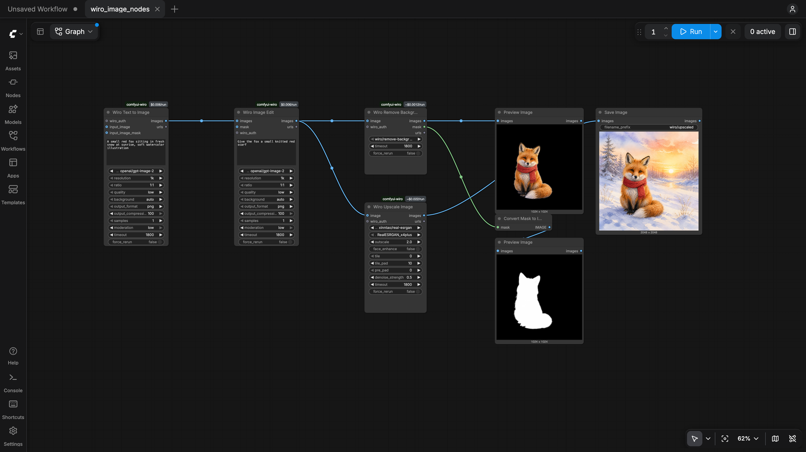

## Category nodes

Pick a model from the menu and the node shows that model's own settings, with the choices and defaults from its Wiro AI model page. The inputs every model of the category shares (prompt, reference images, frames, audio) stay at the top of the node, so links and text survive a model change.

| Node | What it does | Inputs | Outputs |
| --- | --- | --- | --- |
| **Wiro Text to Image** | Images from a prompt, with any text-to-image model in the catalog | prompt | images, urls |
| **Wiro Image Edit** | Edits with reference images and an optional mask | prompt, images, mask | images, urls |
| **Wiro Upscale Image** | Upscales and restores images | image | images, urls |
| **Wiro Remove Background** | Cuts out the subject | image | images, mask, urls |
| **Wiro Text to Video** | Video from a prompt | prompt | video, urls |
| **Wiro Image to Video** | Animates a first frame, with a last frame on models that take one | prompt, first_frame, last_frame | video, urls |
| **Wiro Video Upscale** | Upscales a video | video | video, urls |
| **Wiro Lipsync** | Makes a portrait image or video speak along with an audio track | image, video, audio | video, urls |
| **Wiro Text to Speech** | Speech from text; each model brings its own voices | text | audio, urls |
| **Wiro Music** | Music and songs from a prompt | prompt | audio, urls |
| **Wiro Speech to Text** | Transcripts from speech | audio | text, urls |
| **Wiro 3D** | A 3D model (GLB) from an image, ready for Preview 3D (Advanced) and Save 3D Model | image | GLB, urls |

The menus list every model of that category in the catalog: the node's default model first, then the most used. ComfyUI starts with the last saved copy of the catalog (or the copy that ships with the pack) and refreshes it in the background, so models added to Wiro AI show up after a page reload, without updating the pack. Category nodes need a ComfyUI recent enough to have dynamic combo inputs; on older versions the other nodes keep working.

## More nodes

| Node | What it does | Inputs | Outputs |
| --- | --- | --- | --- |
| **Wiro LLM** | Asks an LLM through the [Wiro LLM gateway](https://wiro.ai/docs/completions-api); the menu lists the gateway's models | prompt, system instructions, images | text |
| **Wiro Run Workflow** | Runs one of your [Wiro AI workflows](https://wiro.ai/docs/workflows) by its slug or link | inputs as JSON, image, audio, video | images, video, audio, text, urls |

## Model nodes

| Node | Model | Inputs | Outputs |
| --- | --- | --- | --- |
| **Wiro Run Model** | Any model, by its `owner/project` slug | prompt, JSON parameters, image, image_2, audio, video | images, video, audio, text, urls |
| **Wiro API Key** | | API key and optional secret | wiro_auth |
| **Wiro Nano Banana Pro** | [google/nano-banana-pro](https://wiro.ai/models/google/nano-banana-pro) | prompt, up to 14 reference images | images, urls |
| **Wiro Nano Banana 2** | [google/nano-banana-2](https://wiro.ai/models/google/nano-banana-2) | prompt, up to 14 reference images | images, urls |
| **Wiro GPT Image 2** | [openai/gpt-image-2](https://wiro.ai/models/openai/gpt-image-2) | prompt, up to 16 input images, mask | images, urls |
| **Wiro Seedream 4.5** | [bytedance/seedream-v4-5](https://wiro.ai/models/bytedance/seedream-v4-5) | prompt, up to 14 reference images | images, urls |
| **Wiro Veo 3.1** | [google/veo3-1](https://wiro.ai/models/google/veo3-1) | prompt, first frame, last frame, reference images | video, urls |
| **Wiro Kling 3** | [klingai/kling-v3](https://wiro.ai/models/klingai/kling-v3) | prompt, first frame, last frame | video, urls |
| **Wiro Seedance 1 Pro Fast** | [bytedance/seedance-v1-pro-fast](https://wiro.ai/models/bytedance/seedance-v1-pro-fast) | prompt, image | video, urls |
| **Wiro Eleven v4 Text to Speech** | [elevenlabs/eleven-v4](https://wiro.ai/models/elevenlabs/eleven-v4) | text, voice, language | audio, urls |
| **Wiro ElevenLabs Music v2** | [elevenlabs/text-to-music-v2](https://wiro.ai/models/elevenlabs/text-to-music-v2) | prompt, duration | audio, urls |
| **Wiro ElevenLabs Speech to Text** | [elevenlabs/speech-to-text](https://wiro.ai/models/elevenlabs/speech-to-text) | audio | text, urls |

The model nodes show each model's own settings (resolution, ratio, duration, voice and so on) as widgets, with the defaults and choices from its Wiro AI model page. All nodes live under **Wiro AI** in the node library; search for "Wiro".

## Prices on the node

Every Wiro node shows a price badge on its title bar, worked out in the browser from the model's pricing on Wiro AI for the settings you picked: `$0.006/run`, `$0.039/output`, `~$0.0037` for 46 characters of speech, `~$0.0012/run` for models priced by processing time, or the gateway's token prices on Wiro LLM. Models billed by what they produce, such as tokens or seconds of output, show `priced by usage`. After a run the badge shows what the task cost, as Wiro reported it (`paid $0.006`), until you change a setting. The ComfyUI console also logs each task with its ID, time and cost.

## Install

**ComfyUI Manager:** open the Manager, choose **Custom Nodes Manager**, search for **Wiro AI**, install it and restart ComfyUI.

**Comfy CLI:**

```bash
comfy node install comfyui-wiro
```

**Manually:** clone the repository into `ComfyUI/custom_nodes` and restart ComfyUI.

```bash
cd ComfyUI/custom_nodes
git clone https://github.com/wiroai/Wiro-ComfyUI comfyui-wiro
```

The only dependency is `requests`, which ComfyUI already installs. If your environment lacks it, run `pip install -r requirements.txt` with the Python that runs ComfyUI.

## Set your API key

Create a project at [wiro.ai/panel/project/new](https://wiro.ai/panel/project/new) and copy its API key. If the project uses signature authentication, copy the API secret too. Then pick one of these:

**Environment variable.** Set `WIRO_API_KEY` (and `WIRO_API_SECRET` for signature projects) before you start ComfyUI. Every Wiro node uses it.

```bash
export WIRO_API_KEY="your-api-key"
python main.py
```

On Windows, use `set WIRO_API_KEY=your-api-key` in Command Prompt or `$env:WIRO_API_KEY="your-api-key"` in PowerShell.

**Wiro API Key node.** Add the node, paste the key into it and connect its `wiro_auth` output to the `wiro_auth` input of your Wiro nodes. A connected key takes priority over the environment variable, and a node left empty falls back to it. The same key works for the LLM gateway and for workflow runs.

The key stays out of everything ComfyUI saves. The node is saved empty in workflow files and in the workflow stored inside images and videos, and the prompt that ComfyUI keeps in its history and in file metadata carries only a reference that works inside your running ComfyUI. The key itself lives in the ComfyUI server's memory, so type it again after you reload a workflow or restart ComfyUI. The environment variable avoids that step.

## Example workflows

The `example_workflows` folder has eleven workflows. They also show up in ComfyUI's template browser, under the folder name the pack was installed with (`comfyui-wiro` or `Wiro-ComfyUI`).

| Workflow | What it does |
| --- | --- |
| [wiro_image_nodes.json](example_workflows/wiro_image_nodes.json) | Wiro Text to Image makes a fox, Wiro Image Edit gives it a scarf, Wiro Remove Background cuts it out with its mask, Wiro Upscale Image doubles its size |
| [wiro_video_nodes.json](example_workflows/wiro_video_nodes.json) | A still from Wiro Text to Image goes through Wiro Image to Video and Wiro Video Upscale; Wiro Text to Video makes a second clip from a prompt |
| [wiro_voice_nodes.json](example_workflows/wiro_voice_nodes.json) | Wiro Text to Speech reads a line, Wiro Lipsync makes a generated portrait say it, Wiro Speech to Text writes it back |
| [wiro_music.json](example_workflows/wiro_music.json) | Wiro Music makes a ten second track |
| [wiro_image_to_3d.json](example_workflows/wiro_image_to_3d.json) | Wiro Text to Image draws a teapot and Wiro 3D turns it into a GLB, shown in Preview 3D (Advanced); scroll in the viewer to zoom in |
| [wiro_llm.json](example_workflows/wiro_llm.json) | Wiro LLM writes an image prompt, Wiro Text to Image draws it, a second Wiro LLM describes the picture |
| [wiro_run_workflow.json](example_workflows/wiro_run_workflow.json) | Wiro Run Workflow runs one of your Wiro AI workflows on a generated image; put your workflow's slug in the node |
| [wiro_text_to_image.json](example_workflows/wiro_text_to_image.json) | Wiro API Key and Wiro GPT Image 2, saved with Save Image |
| [wiro_run_model_llm_to_image.json](example_workflows/wiro_run_model_llm_to_image.json) | One Wiro Run Model asks an LLM for an image prompt, a second one turns that prompt into an image |
| [wiro_image_to_video.json](example_workflows/wiro_image_to_video.json) | Wiro GPT Image 2 makes a still, Wiro Seedance 1 Pro Fast animates it, Save Video keeps the clip |
| [wiro_speech_and_transcript.json](example_workflows/wiro_speech_and_transcript.json) | Wiro Eleven v4 reads a line aloud, Wiro ElevenLabs Speech to Text writes it back as text |

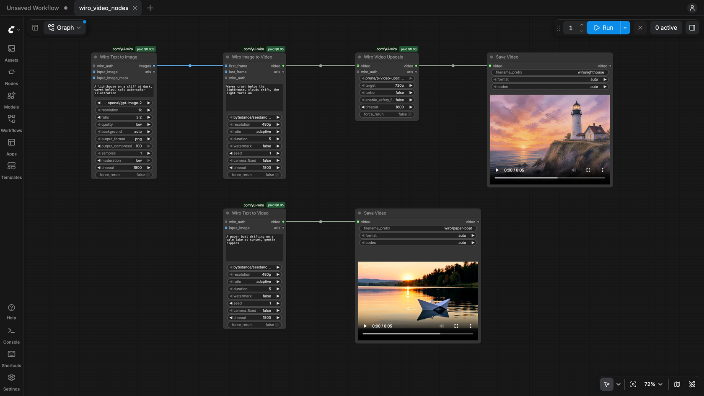

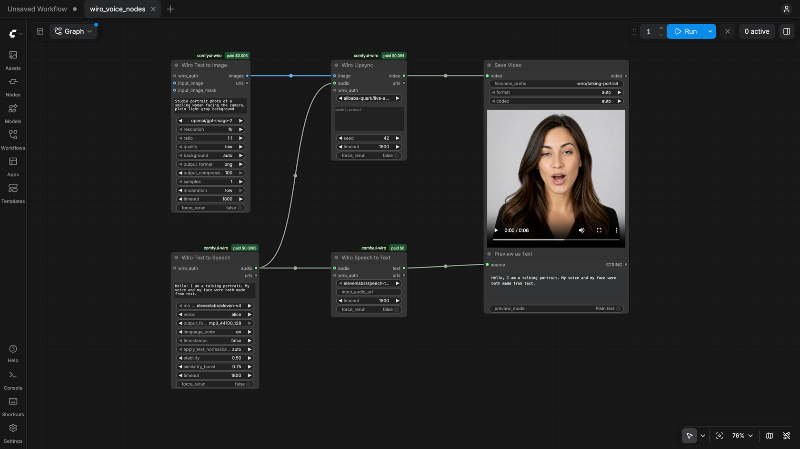

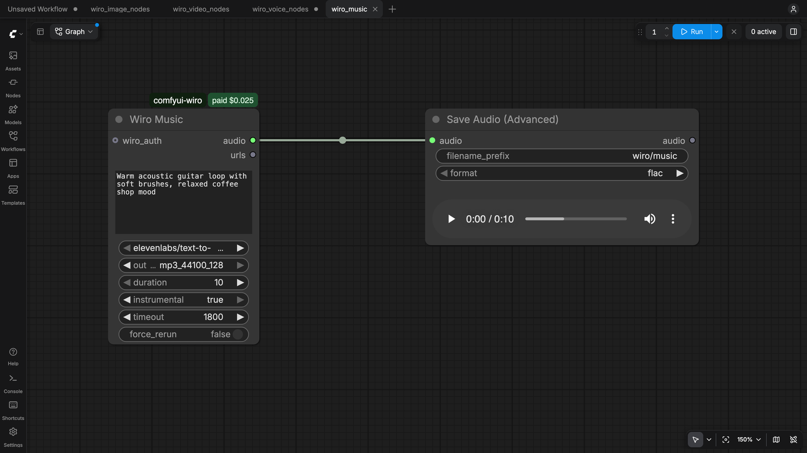

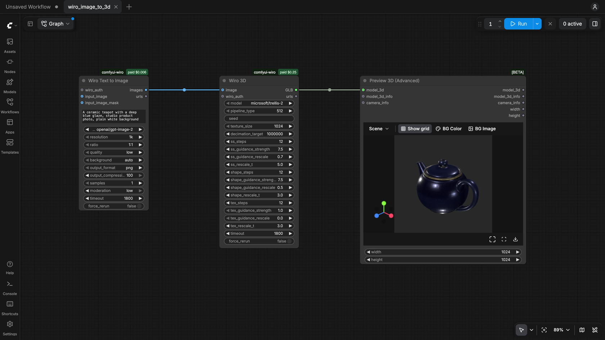

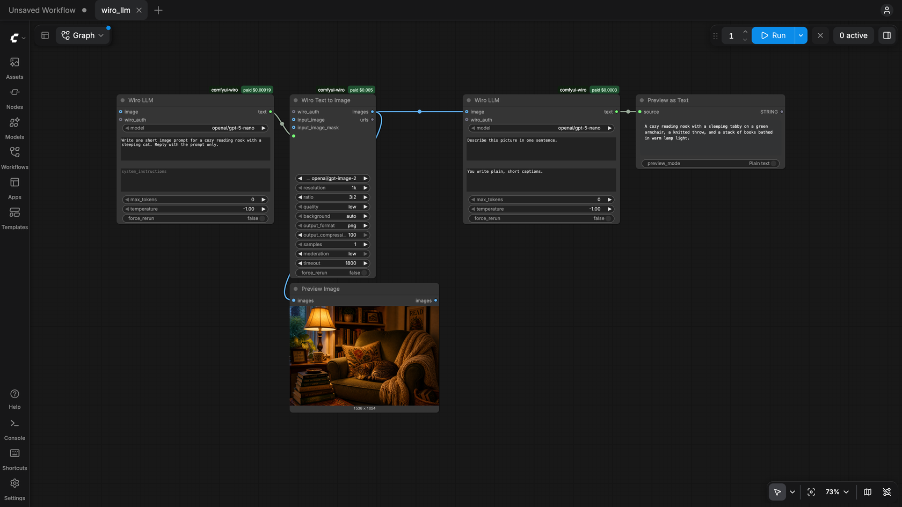

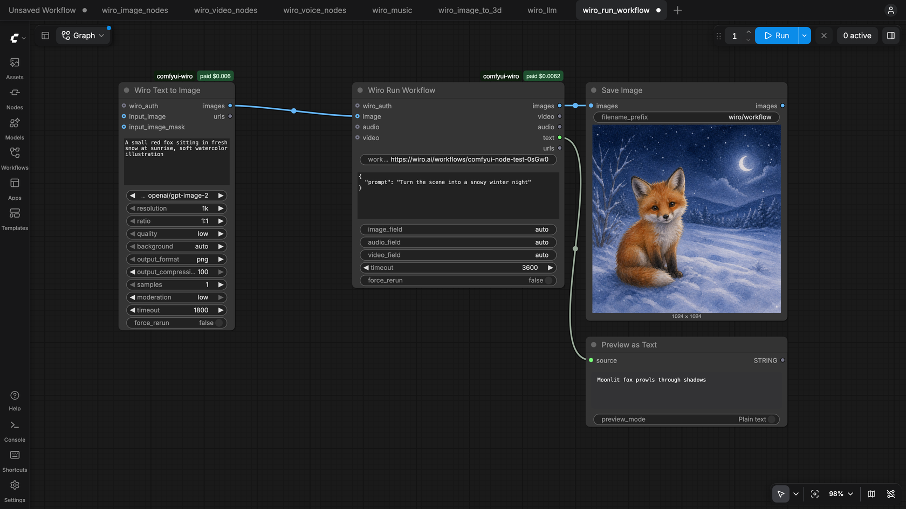

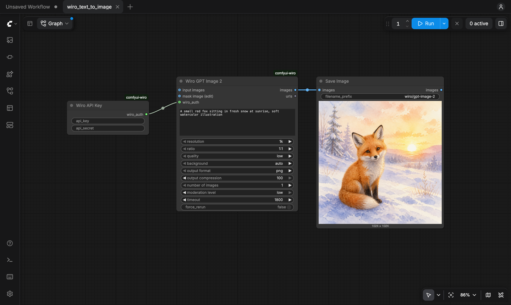

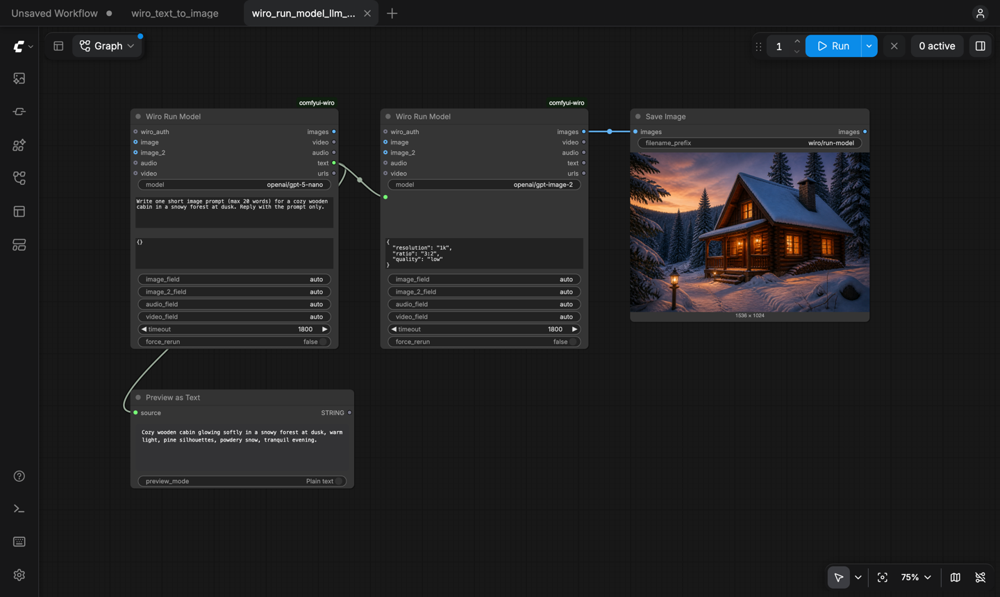

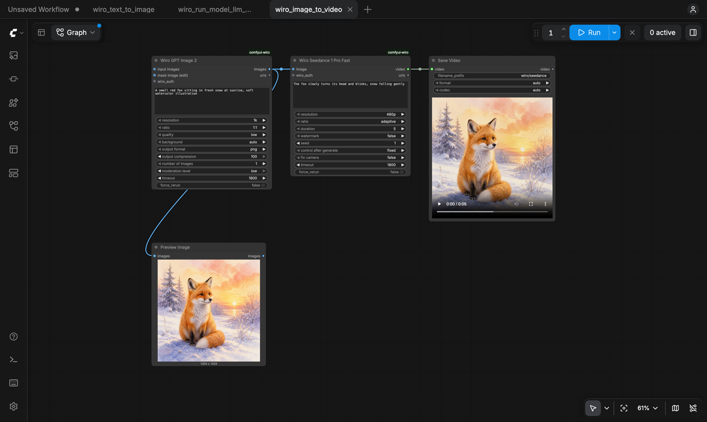

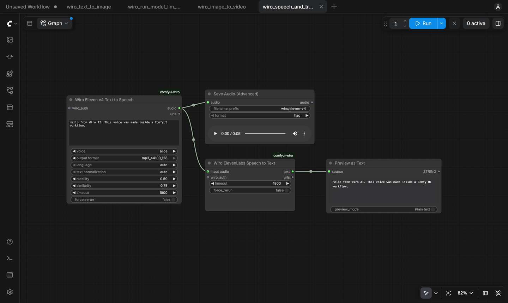

## Wiro Run Model

**model** is the slug from the model's page: `https://wiro.ai/models/google/nano-banana-pro` becomes `google/nano-banana-pro`. Pasting the whole URL works too.

**prompt** is sent as the `prompt` parameter when it is not empty. Connect a text output (for example from another Wiro Run Model running an LLM) to chain models.

**parameters** takes every other setting as a JSON object. The model page lists them, and the [model parameters guide](https://wiro.ai/docs/model-parameters) explains the types. Required settings you leave out get the model's default, as on the model page. Some examples:

| Model | parameters |
| --- | --- |
| `google/nano-banana-pro` | `{"resolution": "2K", "aspectRatio": "16:9"}` |
| `klingai/kling-v3` | `{"mode": "std", "duration": "5", "ratio": "16:9", "sound": "off"}` |
| `google/gemini-3-flash` | `{"systemInstructions": "Answer in one sentence.", "maxOutputTokens": 200}` |

**image, image_2, audio and video** are uploaded with the run. With the `*_field` settings left on `auto`, each one goes to the model's matching input: `image` to its first image input, `image_2` to its second one (a last frame, a garment, a second reference), `audio` and `video` to their own inputs. A batch of images goes in as several files when the input takes more than one. To choose the input yourself, type its parameter name, such as `inputImageHuman`, into the matching `*_field`. URLs work too: put them in the parameters JSON.

**Outputs:** `images` holds every image the model returned as one batch, `video` and `audio` the first video and audio file, `text` the answer of an LLM or the transcript of a speech model, and `urls` every output file URL, one per line. When a model does not produce one of these, the nodes connected to that output do not run and show a short message instead.

## Wiro LLM

Pick a model from the menu, which lists the models on the [Wiro LLM gateway](https://wiro.ai/docs/completions-api) (`llm.wiro.ai`), write a prompt and, if you like, a system instruction. Connect images to ask about them; the node checks that the model reads images. `max_tokens` and `temperature` sit under the advanced inputs, where `0` and `-1` keep the model's defaults. The answer comes out as text, ready for a prompt input or Preview as Text.

## Wiro Run Workflow

Paste a workflow's slug (`product-ad-a1B2c`) or its `wiro.ai/workflows/...` link. You can run your own workflows and the ones listed in the public gallery. Put the values for its Start fields in `inputs` as JSON, keyed by field name. A connected image, audio or video is uploaded to your Wiro AI storage and passed to the workflow's matching Start field (set `image_field`, `audio_field` or `video_field` to pick a field by name). The node waits for the run and returns the files and text its End node shows; each step is billed at its model's price.

## How it works

- A run is a `POST /Run/{owner}/{project}` request: JSON for text-only runs, multipart form data when files are attached ([Run a Model](https://wiro.ai/docs/run-a-model)).
- The node polls `Task/Detail` every few seconds until the task reaches `task_postprocess_end`, then checks `pexit` (`"0"` means success) and downloads the outputs ([Tasks](https://wiro.ai/docs/tasks)). LLM answers come from `debugoutput`.
- While it waits, the node shows the task's status. The ComfyUI console logs one line per task with its ID, time and cost.
- Stopping the queue in ComfyUI also cancels the Wiro task.
- ComfyUI does not run a node again when none of its inputs changed, so queueing the same graph twice reuses the first result. Change any input, or turn on `force_rerun` (under the advanced inputs), to start a new run.
- `timeout` (30 to 7200 seconds, 1800 by default) sets how long a node waits for its task.
- The model menus come from the public catalog endpoint `Tool/List`, the LLM menu from `llm.wiro.ai/v1/models`. Both are saved in ComfyUI's user folder and refreshed every few hours.
- Wiro LLM calls `POST https://llm.wiro.ai/v1/chat/completions`; Wiro Run Workflow uses `Workflow/Run` and polls `Workflow/RunDetail` ([Workflows](https://wiro.ai/docs/workflows)).

## Development

```bash
pip install torch numpy pillow av requests pytest
python -m pytest
```

The unit tests cover request building, authentication headers, task polling, output handling, the catalog, model menus, the LLM and workflow nodes and the key handling, without calling the API. The category node schemas need ComfyUI's node API: point `COMFYUI_PATH` at a ComfyUI checkout to run those tests too (`COMFYUI_PATH=../ComfyUI python -m pytest`).

The fixed model nodes are generated when ComfyUI starts from `wiro_comfyui/models.json`, so loading them needs no network. `scripts/update_models.py` rebuilds that file from the public Wiro AI catalog; edit the list at the top of the script to add a model node. `scripts/update_catalog.py` refreshes the catalog snapshots the menus start from.

## More from Wiro AI

| Repository | What it is |
| --- | --- |
| [Wiro-MCP](https://github.com/wiroai/Wiro-MCP) | Official MCP server for Wiro AI, [`@wiro-ai/wiro-mcp` on npm](https://www.npmjs.com/package/@wiro-ai/wiro-mcp) |
| [Wiro-Plugin](https://github.com/wiroai/Wiro-Plugin) | Wiro AI plugin for Cursor, Claude Code, Gemini CLI and Devin |
| [Wiro-LLM](https://github.com/wiroai/Wiro-LLM) | Wiro AI provider for the Vercel AI SDK and LLM gateway examples, [`@wiro-ai/wiro-llm` on npm](https://www.npmjs.com/package/@wiro-ai/wiro-llm) |
| [Wiro-Zed](https://github.com/wiroai/Wiro-Zed) | Wiro AI MCP server for the Zed editor |
| [Wiro-Action](https://github.com/wiroai/Wiro-Action) | GitHub Action for Wiro AI |
| [Wiro-Hermes](https://github.com/wiroai/Wiro-Hermes) | Wiro AI as a model provider for Hermes Agent |
| [n8n-nodes-wiroai](https://github.com/wiroai/n8n-nodes-wiroai) | Wiro AI nodes for n8n, [`@wiro-ai/n8n-nodes-wiroai` on npm](https://www.npmjs.com/package/@wiro-ai/n8n-nodes-wiroai) |
| [Wiro-Chromium-Extension](https://github.com/wiroai/Wiro-Chromium-Extension) | Wiro AI extension for Chrome, Edge, Opera and Brave |
| [Wiro-Firefox-Extension](https://github.com/wiroai/Wiro-Firefox-Extension) | Wiro AI add-on for Firefox |
| [Wiro-Safari-Extension](https://github.com/wiroai/Wiro-Safari-Extension) | Wiro AI extension for Safari on the Mac |
| [Swift-QuickStart](https://github.com/wiroai/Swift-QuickStart) | WiroKit, the Wiro AI SDK for iOS |
| [Kotlin-QuickStart](https://github.com/wiroai/Kotlin-QuickStart) | WiroKit, the Wiro AI SDK for Android |
| [Dart-QuickStart](https://github.com/wiroai/Dart-QuickStart) | Wiro AI SDK for Dart and Flutter, [`wiro` on pub.dev](https://pub.dev/packages/wiro) |
| [ReactNative-QuickStart](https://github.com/wiroai/ReactNative-QuickStart) | Wiro AI SDK for React Native and Expo, [`@wiro-ai/wiro-react-native` on npm](https://www.npmjs.com/package/@wiro-ai/wiro-react-native) |
| [Swift-Realtime](https://github.com/wiroai/Swift-Realtime) | Realtime voice AI example for iOS |
| [Kotlin-Realtime](https://github.com/wiroai/Kotlin-Realtime) | Realtime voice AI example for Android |
| [Dart-Realtime](https://github.com/wiroai/Dart-Realtime) | Realtime voice AI example for Flutter |
| [ReactNative-Realtime](https://github.com/wiroai/ReactNative-Realtime) | Realtime voice AI example for React Native |
| [Wiro-Dify-Plugin](https://github.com/wiroai/Wiro-Dify-Plugin) | Wiro AI plugins for Dify: the LLM gateway as a model provider, plus image, video, speech and music tools |
| [Wiro-Docs](https://github.com/wiroai/Wiro-Docs) | Source of the Wiro AI API docs |

[Website](https://wiro.ai) · [Models](https://wiro.ai/models) · [Docs](https://wiro.ai/docs) · [X](https://x.com/wiroai)

## License

MIT, see [LICENSE](./LICENSE).
